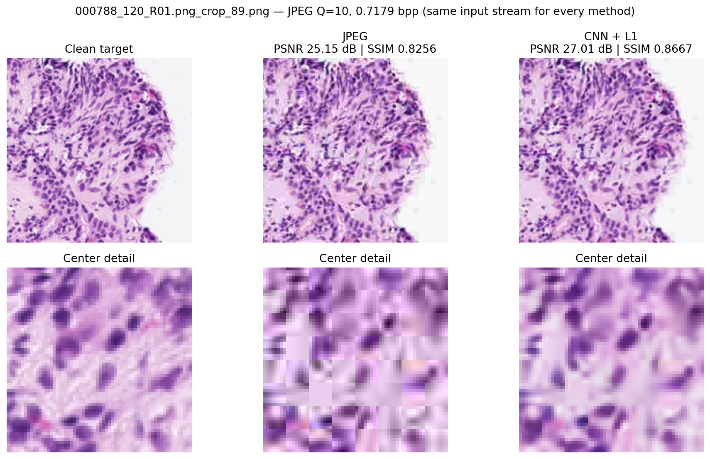
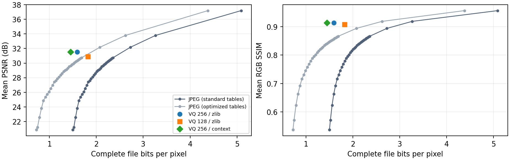

# JPEG Artifact Restoration and Learned Image Compression
Parteek Dheri · University of Toronto · ECE1512, Fall 2026
Project repository: https://github.com/dheri/ECE1512_Project-B

**Abstract.** This study distinguishes improving pixels after JPEG decoding from learning what to store in a new bitstream. On 1,576 held-out ADPPatches crops, a residual CNN improved mean PSNR by 1.88–2.03 dB at five JPEG qualities without changing the number of transmitted bytes. A simplified RDVQ-inspired codec achieved 31.51 dB PSNR and 0.9134 SSIM at 1.596 full-file bits per pixel on 256 smaller crops. Two post-training ablations separate the effect of codebook capacity from that of lossless entropy coding. The dataset partitions hold out patches, not all source images; the results do not establish generalization to unseen tissue sources.

<!-- columns -->
## I. Introduction and Related Work

**JPEG.** The standard transform-coding pipeline [1] converts samples into frequency coefficients with an 8×8 block DCT. Quantization divides the coefficients by frequency-dependent steps and rounds the results. Standard baseline JPEG orders and entropy-codes the quantized symbols. The entropy coder is lossless; quantization discards information. A low encoder quality setting makes quantization coarser, often giving visible block boundaries, ringing near edges, and loss of fine texture. The Pillow quality factor Q is an encoder control, not a bitrate. Different images at the same Q produce different file sizes. Our JPEG encodes use 4:4:4 sampling (no chroma subsampling).

**Restoration.** The decoded JPEG is the degraded observation in a supervised inverse problem. A CNN can use nearby pixels to infer a plausible correction, an approach also demonstrated by ARCNN [2]. In our system, the decoder-side CNN reads the existing pixels; the transmitted JPEG stream never changes. Reduced error against a clean target does not prove that lost features were recovered faithfully.

**Learned compression.** An analysis network maps pixels to a latent representation; quantization yields discrete symbols; entropy coding turns them into bytes; a synthesis network reconstructs the image. The rate–distortion objective trades distortion against expected coding cost. This differs from restoration because the network determines what is transmitted.
<!-- column -->
### From scalar to vector quantization

**Ballé et al. [3].** They jointly learned nonlinear analysis and synthesis transforms around uniform scalar quantization. A continuous relaxation makes training possible despite discrete rounding. The factorized latent model does not explicitly predict spatial dependencies.

**Minnen et al. [4].** A hierarchical hyperprior provides side information, and an autoregressive prior conditions on previously decoded symbols. The two sources of context improve rate prediction, but sequential context increases decoding cost.

**ELIC [5].** Uneven groups exploit the concentration of information in some latent channels; already decoded groups and spatial context predict later groups. Grouped scheduling reduces sequential overhead relative to per-symbol context. ELIC still codes scalar latent values, not vector codeword IDs.

**RDVQ [6].** A distance-based soft assignment lets the rate gradient reach the encoder even though the stored representation uses hard vector codebook IDs. A masked autoregressive transformer estimates context-dependent symbol probabilities and supports test-time completion from a transmitted prefix. Its perceptual and adversarial objectives target plausible detail at very low rates. This is not the same claim as high pixel fidelity or diagnostic validity.

**Scope.** We reproduce the differentiable vector-quantization mechanism using the course starter [8], not the paper’s entire multi-scale generative model. The experiments use ADPPatches [7] and prioritize measured file size, PSNR, and RGB SSIM.
<!-- /columns -->

<!-- page -->
<!-- columns -->
## II. JPEG Artifact Restoration

**Model.** For clean RGB crop x and JPEG-decoded input y, the model predicts a correction fθ(y). The reconstructed crop is clip(y + fθ(y), 0, 1). Five 3×3 convolutions keep the spatial dimensions; the first four use 32 channels and ReLU, while the last maps to three channels. The model has 29,507 trainable parameters. The residual connection lets it retain the decoded signal and focus on the correction. The loss is the mean absolute RGB error, L1.

**Protocol.** The full run used 12,616 training, 1,576 validation, and 1,576 test PNGs. Training sampled 256×256 crops, random flips, and Q in {10, 20, 30, 40, 50}. Evaluation used center crops; images smaller than the target size were first resized bicubically. Validation assigned deterministic JPEG qualities by image index. We used seed 42, batch size 16, AdamW (initial learning rate 0.0002 and weight decay 0.0001), and a three-epoch cosine schedule. We selected epoch 3 by validation restoration PSNR (31.47 dB vs. 29.66 dB before restoration).
<!-- column -->
### Metrics and interpretation

PSNR is −10 log10(MSE) on RGB in [0, 1], averaged after computing each image’s PSNR. SSIM [9] uses per-channel 11×11 Gaussian windows (σ = 1.5), excludes the five-pixel border, and averages equally across images. For each Q, both methods see exactly the same 1,576 crops and JPEG bitstreams. Reported BPP includes the JPEG headers.

Table I shows gains at every required Q, including unseen Q15 and Q25. The largest mean SSIM gain is at Q10, where blocking is strongest. In Fig. 1, the CNN weakens block boundaries around dark nuclei but cannot recreate all of the clean image’s texture. In the archived Q25 example (index 1575), PSNR rises from 30.74 to 31.56 dB while SSIM falls from 0.8546 to 0.8465. The CNN removes some weak boundaries along with artifacts. Mean gains do not imply improvement on every crop.
<!-- /columns -->

Table I. Mean quality on the full restoration test split; both methods use the same BPP.
| Q | File BPP | JPEG PSNR | CNN PSNR | JPEG SSIM | CNN SSIM |
| --- | --- | --- | --- | --- | --- |
| 10 | 0.600 | 26.37 | 28.25 | 0.7708 | 0.8309 |
| 15 | 0.747 | 27.85 | 29.88 | 0.8122 | 0.8677 |
| 20 | 0.879 | 28.87 | 30.90 | 0.8378 | 0.8876 |
| 25 | 1.004 | 29.64 | 31.62 | 0.8553 | 0.9001 |
| 30 | 1.119 | 30.24 | 32.14 | 0.8681 | 0.9084 |

<!-- page -->
<!-- columns -->
## III. Learned Compression

### A. What is actually stored

The encoder maps normalized RGB to a single latent grid. A 4×4 stride-2 convolution produces 64 channels; a SiLU residual block refines the features and a 1×1 projection produces 16-dimensional vectors. A 64×64 crop yields a 32×32 grid. Each vector selects one of K = 256 learned codewords, giving 1,024 integer IDs. Each ID fits into eight bits before lossless coding. The baseline packs the IDs and applies zlib. A file header carries dimensions, symbol width, and a fingerprint of the shared checkpoint. It does not carry the codebook or the neural weights.

The decoder retrieves codeword vectors by ID. A 1×1 projection lifts them to 64 channels; a residual block, nearest-neighbor upsampling, and convolutions reconstruct RGB with a final sigmoid. The codec pads odd input dimensions before encoding and crops back to the original shape after decoding. The saved baseline has 195,987 trainable parameters.

### B. Rate–distortion objective

For latent vector z_i and codeword e_k, compute d_ik = ||z_i − e_k||². The soft assignment is p_ik = softmax_k(−d_ik/τ). The soft vector is the probability-weighted sum of the codebook vectors. A learned categorical prior r = softmax(a) assigns an approximate bit cost −log2(r_k) to each index. With B images of height H and width W, the training objective is:

L = MSE(x, x̂) + λ R_soft

R_soft = Σ_ik p_ik [−log2(r_k)] / (B H W).

MSE rewards fidelity; the second term rewards assignments that the learned prior can predict. The prior in this loss is not zlib, so its estimate need not equal the actual file rate.
<!-- column -->
### C. Soft training versus hard coding

Nearest-neighbor selection changes discontinuously, so differentiating directly through the stored ID would not train the encoder. The straight-through estimator gives the decoder the hard vector on the forward pass but sends reconstruction gradients through the soft mixture on the backward pass. The rate loss uses soft probabilities directly, giving the encoder and codebook a rate gradient. Geometric cooling makes soft assignments more concentrated without transmitting any soft values. Validation and test use hard nearest-neighbor indices; validation selects the minimum hard MSE + λ times estimated hard rate.

**Training.** Seed 1512 selected fixed subsets of 1,024 training, 128 validation, and 256 test patches from the prepared folders. We used 64×64 crops and batch size 32. Eight continuous-autoencoder warm-up epochs preceded k-means on 32,768 training latent vectors. Forty quantized epochs used Adam, learning rate 0.0002, gradient-norm clipping at 1, λ = 0.0001, and an actual temperature schedule from 0.027519 to 0.005504. The saved quantized configuration gives the schedule used by the optimizer. Epoch 40 attained the lowest hard validation objective.

### D. Relationship to RDVQ

Both systems use vector codewords, hard reconstruction, and a differentiable rate term so the rate objective can shape the encoder. RDVQ [6] uses multi-scale latents and transformer-based conditional entropy coding, and adds perceptual and adversarial training terms. Our single-grid baseline uses a global categorical prior and a separate file coder; it does not implement prefix completion. The context ablation adds a local lossless coder, not the paper’s transformer. Neither the paper’s published rates nor its perceptual claims are reproduced here.
<!-- /columns -->

<!-- page -->
<!-- columns -->
## IV. Codec Evaluation and Ablations

**Comparison.** All codecs encode the same 256 center crops. Actual BPP is eight times total full-file bytes divided by total input pixels. We score the decoded arrays, not the encoder’s forward estimate. The shared checkpoint is excluded from per-image BPP and reported separately. Dense JPEG points near the learned baseline give a local comparison; optimized Huffman tables test sensitivity to the JPEG setting without changing the quantized coefficients.

The baseline reaches 31.51 dB and 0.9134 at 1.596 BPP. The nearest standard JPEG point is Q5: 1.594 BPP, 23.82 dB, SSIM 0.6632. The nearest optimized-table point is Q28: 1.593 BPP, 30.34 dB, SSIM 0.8570. These are nearby operating points, not identical rates. The learned checkpoint is assumed to be available at the receiver.
<!-- column -->
### Controlled interventions

**Codebook capacity.** Keep the 128 most frequent of 256 codewords using the original training-subset center crops. Remap the retained IDs and reassign each latent to its nearest surviving word. Hold encoder, decoder, zlib, and test crops fixed, with no fine-tuning. This measures pruning sensitivity, not the performance of a separately trained 128-entry model.

**Entropy coding.** Keep the full 256-entry model and fit left/up index-frequency tables on the same training crop subset. The context-enabled container selects the smallest of zlib, left-context arithmetic, and up-context arithmetic per image. Encoding and decoding recovered the same integer grids and reconstructions, so any change is in rate, not fidelity. This comparison includes the context container’s extra header bytes.
<!-- /columns -->

Table II. Learned variants on the same 256 crops. Checkpoint sizes are not included in BPP.
| Codec | File BPP | Payload BPP | PSNR (dB) | SSIM | Shared KiB |
| --- | --- | --- | --- | --- | --- |
| VQ 256 / zlib | 1.596 | 1.332 | 31.51 | 0.9134 | 772.1 |
| VQ 128 / zlib | 1.825 | 1.561 | 30.90 | 0.9079 | 763.9 |
| VQ 256 / context | 1.451 | 1.139 | 31.51 | 0.9134 | 1287.5 |

<!-- page -->

<!-- columns -->
## V. Discussion and Lessons Learned

**Restoration is not compression.** The residual CNN improved mean quality without changing the JPEG file. The learned codec changed the representation. For the baseline, the training prior estimated 1.942 BPP on test, the measured payload used 1.332 BPP, and full files used 1.596 BPP. These three rates answer different questions. For small crops, counting headers and reporting shared decoder weights materially changes the comparison.

**What the ablations show.** The retained codewords covered 90.3% of calibration assignments. Pruning increased full-file rate by 0.229 BPP and changed PSNR by -0.62 dB. Fewer nominal bits per index did not guarantee a smaller zlib stream after reassignment and repacking. The context-enabled container chose arithmetic coding for 236 of 256 crops and lowered full-file rate by 0.145 BPP at unchanged quality. Its shared checkpoint is larger because the decoder also needs the fitted frequency tables.

**Limitations.** Both studies use single training seeds and prepared patch splits that share named source images. JPEG’s headers occupy a larger fraction on 64×64 crops than on full images; 4:4:4 JPEG is a specific baseline, not every JPEG setting. Results do not establish out-of-domain or clinical performance. Visual similarity cannot verify preservation of individual diagnostic structures. Larger source-disjoint test images and several learned operating points would strengthen the comparison.
<!-- column -->
## Reproducibility

The companion package records the input archive hash, split counts, frozen codec paths, hyperparameters, best checkpoints, per-image codec results, restoration aggregates, and decoded example files. The full runs used PyTorch 2.14.1, CPU, and validation-only checkpoint selection. It includes runnable notebooks, the ablation entry point, and a checklist. The teaching notebooks and course handout are credited in [8].

## References

[1] G. K. Wallace, “The JPEG still picture compression standard,” Commun. ACM, 1991. https://doi.org/10.1145/103085.103089

[2] C. Dong et al., “Compression artifacts reduction by a deep convolutional network,” ICCV, 2015. https://openaccess.thecvf.com/content_iccv_2015/html/Dong_Compression_Artifacts_Reduction_ICCV_2015_paper.html

[3] J. Ballé, V. Laparra, and E. P. Simoncelli, “End-to-end optimized image compression,” ICLR, 2017. https://arxiv.org/abs/1611.01704

[4] D. Minnen, J. Ballé, and G. D. Toderici, “Joint autoregressive and hierarchical priors for learned image compression,” NeurIPS, 2018. https://arxiv.org/abs/1809.02736

[5] D. He et al., “ELIC: Efficient learned image compression with unevenly grouped space-channel contextual adaptive coding,” CVPR, 2022. https://arxiv.org/abs/2203.10886

[6] S. Jiang et al., “Differentiable vector quantization for rate-distortion optimization of generative image compression,” CVPR, 2026. https://arxiv.org/abs/2604.10546

[7] L. Ye, “ADPPatches,” dataset. https://huggingface.co/datasets/LeonYe/ADPPatches

[8] L. Ye, “ECE1512 Project B: From DNN Image Restoration to Learned Image Compression,” course slides and starter notebooks, 2026.

[9] Z. Wang et al., “Image quality assessment: From error visibility to structural similarity,” IEEE Trans. Image Process., 2004. https://doi.org/10.1109/TIP.2003.819861
<!-- /columns -->
